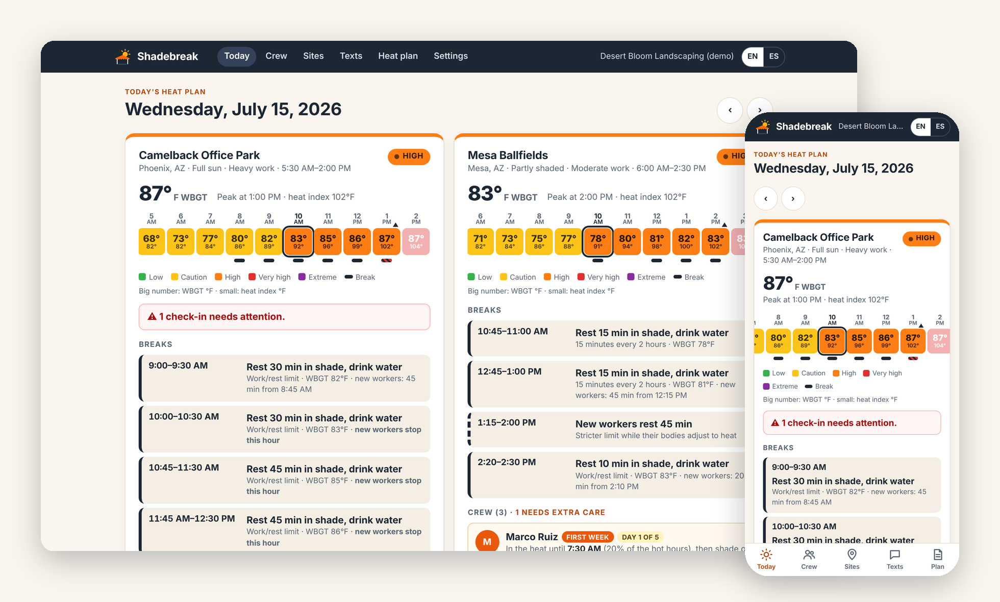
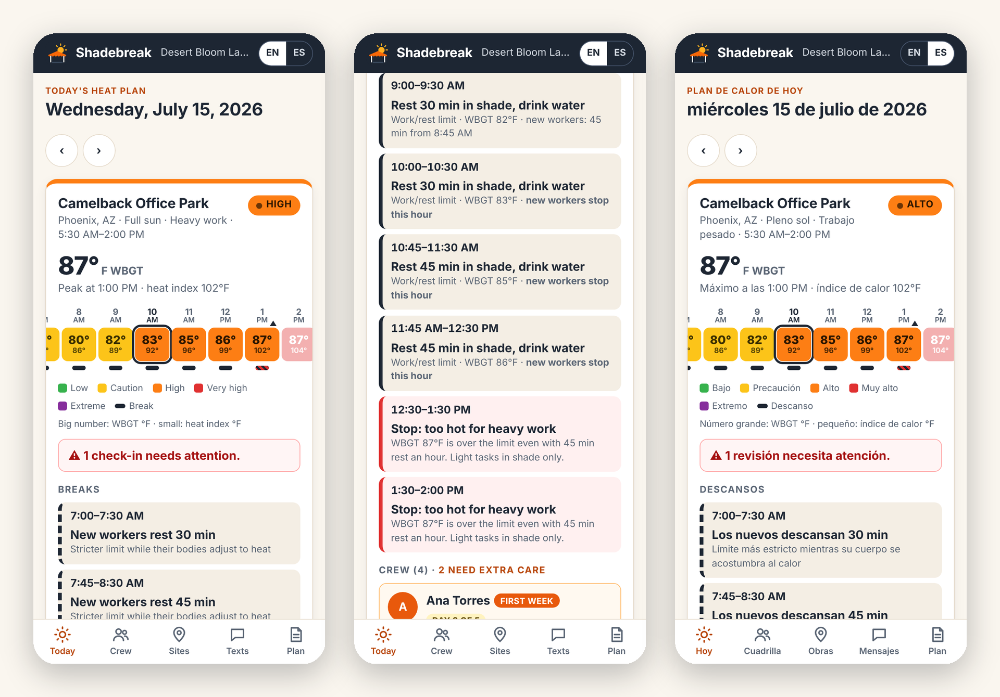
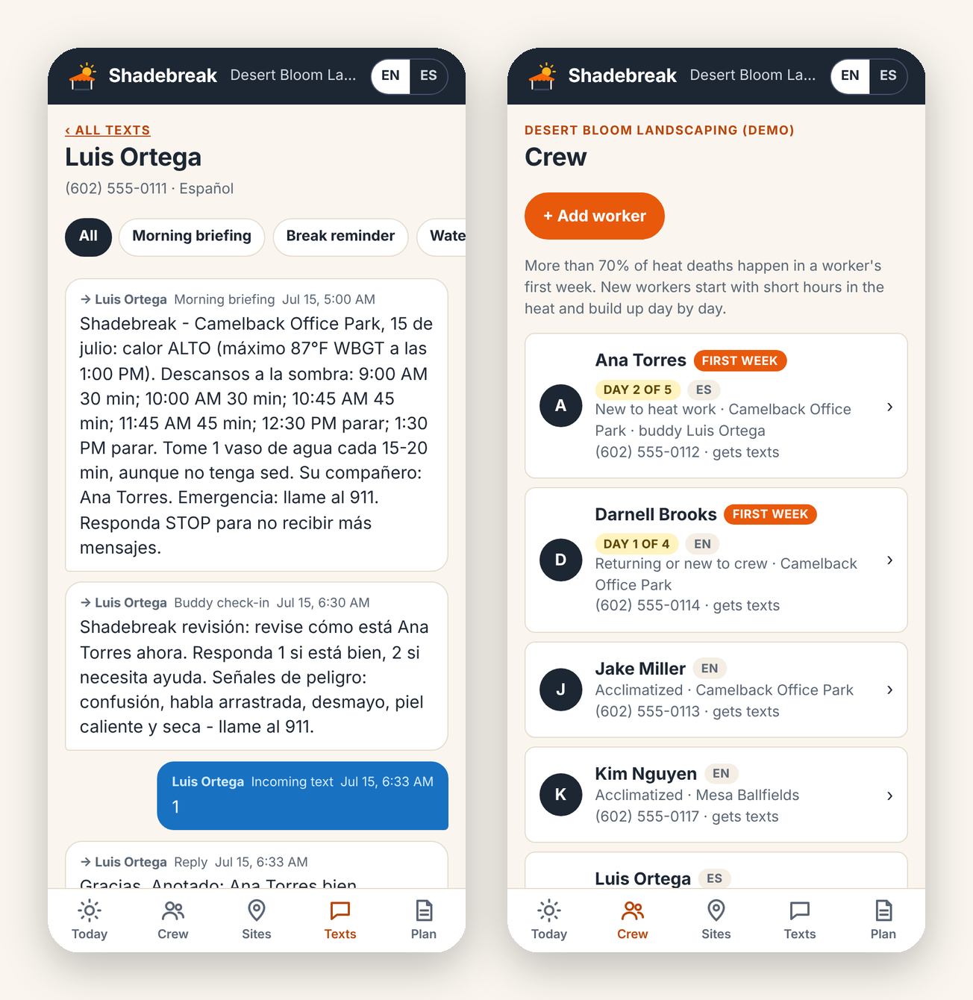
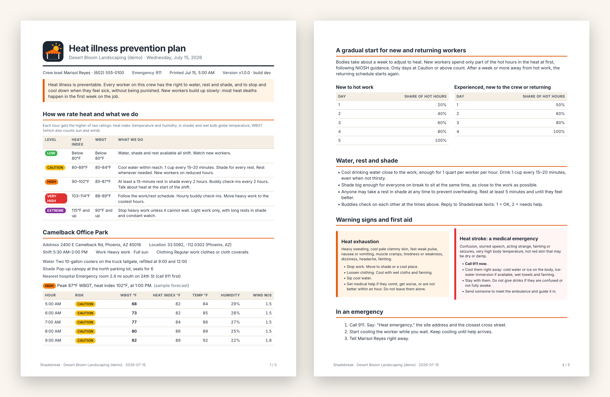
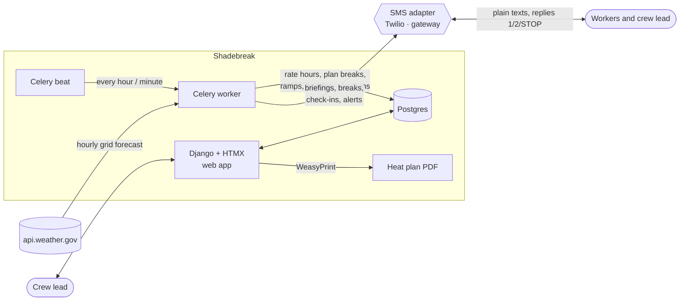

<div align="center">


# Shadebreak

**Water, rest, shade and a gradual start, planned for your crew every morning.**

Heat-illness prevention for small landscaping, roofing, farm and construction crews
that have no safety officer. Bilingual (English / Español). Free and open source.

[](https://github.com/lobojoel2003/Shadebreak/actions/workflows/ci.yml)
[](https://github.com/lobojoel2003/Shadebreak/actions/workflows/codeql.yml)
[](https://github.com/lobojoel2003/Shadebreak/releases/latest)
[](https://github.com/lobojoel2003/Shadebreak/pkgs/container/shadebreak)
[](pyproject.toml)
[](https://www.djangoproject.com/)
[](LICENSE)



</div>

## Why

Heat kills workers, mostly new ones, and the fixes are simple: water, rest, shade
and a gradual start. Small crews have no one to plan that each morning.

* Federal statistics count about **480 worker heat deaths a year**, which OSHA calls
  a vast underestimate; Public Citizen estimates up to **2,000**
  ([KFF Health News](https://kffhealthnews.org/news/article/proposed-federal-heat-labor-rule-outdoor-workers-deaths/)).
* **More than 70%** of workers who die of heat die in their **first week** on the
  job (same article, citing the Labor Department).
* The federal rule **proposed in 2024** would cover about 36 million workers:
  water and shade above 80 °F, paid 15-minute breaks every two hours above 90 °F,
  and time for new workers to acclimatize (same article). Its current status was
  not verified for this release; check
  [osha.gov](https://www.osha.gov/heat-exposure/rulemaking) and your state's rules.
* The official OSHA-NIOSH Heat Safety Tool app "is not receiving updates at this
  time" and uses heat index, which can read **up to 15 °F low in full sun**
  ([CDC NIOSH](https://www.cdc.gov/niosh/heat-stress/communication-resources/app.html)).
  It is built for one person at one location, with no crew, no acclimatization
  schedule and no record.

## What it does

A crew lead enters job sites and workers once. Every morning Shadebreak:

| | |
| --- | --- |
| 🌤️ **Pulls the forecast** | Hourly National Weather Service forecast for each site from the free [api.weather.gov](https://www.weather.gov/documentation/services-web-api). |
| 🌡️ **Rates the heat** | Heat index *and* wet bulb globe temperature (WBGT), which counts sun and wind, estimated with the Liljegren method in ECMWF's [`thermofeel`](https://github.com/ecmwf/thermofeel). Five levels from Low to Extreme. |
| ⏸️ **Schedules breaks** | Work/rest cycles from the ACGIH limits for the site's workload and clothing, a 15-minute rest every 2 hours at High heat, and *stop* blocks when the work is too heavy for the heat. |
| 📈 **Ramps up new workers** | The NIOSH schedule, day by day: 20 → 40 → 60 → 80 → 100% of the hot hours for new workers, 50 → 60 → 80 → 100% for returning ones. First-week workers are flagged. |
| 🤝 **Runs buddy check-ins** | Pairs new workers with experienced ones and texts buddies every 1–2 hours: *reply 1 if OK, 2 if they need help*. No reply or a "2" alerts the crew lead. |
| 💬 **Texts everyone** | Morning briefings, break and water reminders and check-ins by plain SMS in English or Spanish. Nobody installs anything. |
| 🖨️ **Prints a written heat plan** | A PDF for the site binder: triggers, hourly forecast, breaks, who is new and until when, buddies, warning signs, first aid, emergency steps and a sign-off sheet. |

## Screenshots

**The crew lead's morning screen.** Today's risk by hour as a colored strip (big
number WBGT, small number heat index), when breaks fall, who is in their first week
with their reduced hours, and check-ins as they come in. One tap switches to Spanish.



**Texts and crew.** Each worker's texts arrive in their language; replies update the
dashboard. The crew list shows who is new and on day what of their ramp.



**The written heat plan** ([English PDF](https://github.com/lobojoel2003/Shadebreak/releases/latest/download/shadebreak-sample-heat-plan-en.pdf) ·
[Spanish PDF](https://github.com/lobojoel2003/Shadebreak/releases/latest/download/shadebreak-sample-heat-plan-es.pdf)).



> The screenshots use the built-in demo crew and a **sample** forecast for a July day
> in Phoenix, labelled as such in the app.

## How it decides

Every rule lives in the [`heat/`](heat) package (plain, tested Python) and is
explained with sources in **[docs/heat-science.md](docs/heat-science.md)**.

| Level | Heat index | WBGT | What changes |
| --- | --- | --- | --- |
| 🟢 Low | < 80 °F | < 80 °F | Water and shade available |
| 🟡 Caution | 80–89 °F | 80–84.9 °F | Water every 15–20 min, new workers on reduced hours, hourly check-ins for them |
| 🟠 High | 90–102 °F | 85–87.9 °F | 15-min rest at least every 2 h, buddy check-ins every 2 h |
| 🔴 Very high | 103–114 °F | 88–89.9 °F | Work/rest cycles, hourly check-ins |
| 🟣 Extreme | ≥ 115 °F | ≥ 90 °F | Heavy work stops; light work only |

Each hour gets the higher of the two ratings. Rest per hour comes from the ACGIH
TLV (acclimatized) or Action Limit (acclimatizing) for the site's workload, and
only hot hours count toward a new worker's reduced time.

## Quick start

### Try the demo (no network needed)

```bash
git clone https://github.com/lobojoel2003/Shadebreak.git && cd Shadebreak
```

```bash
python -m venv .venv && . .venv/bin/activate && pip install -r requirements-dev.txt
```

```bash
python manage.py migrate && python manage.py seed_demo --password demo-pass-123
```

```bash
DJANGO_DEBUG=1 python manage.py runserver
```

Open http://127.0.0.1:8000 and sign in as **demo** / **demo-pass-123**. PDF export
needs Pango (`apt install libpango-1.0-0 libpangoft2-1.0-0`, or `brew install pango`).

### Run it for real (Docker Compose)

```bash
cp .env.example .env
```

Set `DJANGO_SECRET_KEY`, your host name and `SHADEBREAK_NWS_USER_AGENT` in `.env`, then:

```bash
docker compose up -d
```

This starts the web app, a Celery worker, Celery beat, Postgres and Redis from the
published image `ghcr.io/lobojoel2003/shadebreak`. Sign up at
http://localhost:8000/signup/, add a site and your crew, and the plan appears.
See **[docs/deployment.md](docs/deployment.md)** for HTTPS, upgrades, backups and
platform hosting.

### Turn on text messages

Twilio or any HTTP SMS gateway (for example an Android phone running a gateway app)
works. See **[docs/sms.md](docs/sms.md)**. Until you configure one, texts are written
to the log so you can see exactly what would be sent.

## Architecture



| Path | What lives there |
| --- | --- |
| [`heat/`](heat) | Solar position, heat index, WBGT, risk levels, ACGIH work/rest, NIOSH ramp, break and check-in planner |
| [`nws/`](nws) | National Weather Service API client and grid parser |
| [`crews/`](crews) | Crews, sites, workers, forecasts, work days, breaks, check-ins; planning services, views, PDF plan |
| [`messaging/`](messaging) | SMS backends, bilingual message text, scheduling, inbound replies, escalation |
| [`shadebreak/`](shadebreak) | Settings, Celery, base templates, CSS, Spanish translations, version and build info |
| [`tests/`](tests) | 230+ tests (pytest), run on Postgres in CI |

Stack: Django 5.2 LTS, Postgres, Celery + Redis, HTMX, WeasyPrint, `thermofeel`,
Gunicorn and WhiteNoise. No JavaScript build step.

## Development

```bash
make install     # dependencies
make demo        # demo crew
make dev         # http://127.0.0.1:8000
make test        # tests with coverage
make lint        # ruff
make messages    # refresh Spanish translations
make plan        # sample heat plan PDFs in dist/
make screenshots # regenerate these README images
```

See [CONTRIBUTING.md](CONTRIBUTING.md). Changes to heat rules must cite their source.

## Versions, builds and releases

* **Semantic versioning.** The version lives in [`shadebreak/__init__.py`](shadebreak/__init__.py)
  and every change is recorded in [CHANGELOG.md](CHANGELOG.md).
* **Build numbers.** Every build is stamped with a build number (the commit count on
  `main`), the commit and the date, shown in the page footer
  (`v1.0.0 · build 42 · abc1234`), the PDF, `/version` and the image labels.
* **Tags and releases.** When `main` carries a new version, the Release workflow runs the
  full CI, creates the annotated tag `vX.Y.Z`, publishes Docker images (`X.Y.Z`, `X.Y`,
  `X`, `latest`, `build-N`) to GHCR and a
  [GitHub release](https://github.com/lobojoel2003/Shadebreak/releases) with the wheel,
  sdist, sample heat plans and checksums. Details in [docs/releasing.md](docs/releasing.md).

## CI/CD

| Workflow | Runs on | What it does |
| --- | --- | --- |
| [CI](.github/workflows/ci.yml) | every push and pull request | Ruff; tests on Postgres + Redis for Python 3.12 and 3.13; `check --deploy`; migration check; wheel contents; Docker build and smoke test; on `main`, publishes `edge` and `build-N` images |
| [Release](.github/workflows/release.yml) | new version on `main`, or a `v*.*.*` tag | Checks the version against the changelog, runs CI, tags `vX.Y.Z`, publishes images and the GitHub release |
| [CodeQL](.github/workflows/codeql.yml) | pushes, pull requests, weekly | Security analysis of Python, JavaScript and workflows |
| [Dependabot](.github/dependabot.yml) | weekly | Updates Python packages, the base image and actions |

## Limits

Shadebreak is a planning aid built on public guidance. It is **not** medical advice,
it cannot see a worker, and forecasts can be wrong. Sunlight is estimated from sky
cover, so WBGT is an estimate; measure on site when you can. It does not replace a
qualified safety professional or the OSHA and state rules that apply to you. In an
emergency, call 911.

## License

[GNU Affero General Public License v3.0](LICENSE). If you run a modified version for
others, share your changes.

## Acknowledgements

The National Weather Service for a free, open forecast API; ECMWF for `thermofeel`;
NIOSH, OSHA and ACGIH for the guidance this follows; and every crew lead who plans
water and shade before the sun comes up.
